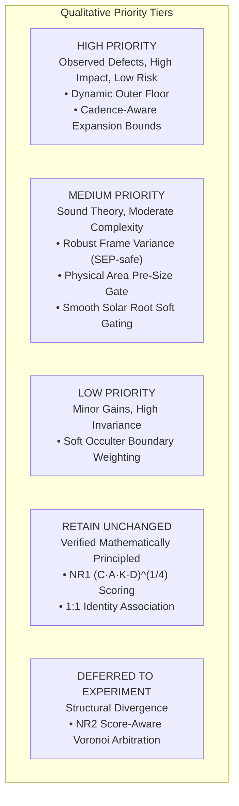

# Stereo_COR2 Pipeline Principled Improvement Roadmap

**Document Reference**: `ROADMAP-PRINCIPLED-2026-11`  
**Date**: November 26, 2026  
**Status**: Research Prioritization & Experimental Design  
**Branch**: `experiment/full-pipeline-audit` (derived from `39d5691`)  
**Baseline Standard**: Dual-Archive D4 Detection + A5b-NR1 Normalized Tracking

---

## 1. Executive Summary & Prioritization Framework

This roadmap establishes a principled, evidence-based research plan for systematically refining the STEREO-A COR2 CME detection and tracking pipeline. In accordance with the project directives, **A5b-NR1 (`v11_redesigned_normalized_a5b.py`)** is adopted as the selected tracking model, successfully resolving the 48.3% multiplicative zero-collapse and 23.3% saturation defects of A5b-N while maintaining **100% bitwise identical ownership masks** to the baseline.

Proposed improvements are prioritized qualitatively based on scientific importance, strength of available evidence, generalizability, downstream risk, and ease of controlled evaluation, avoiding arbitrary numerical weighting:

---

## 2. Comprehensive Candidate Improvement Analyses

---

### Candidate 1: Dynamic Instrumental/Coronal Noise Model for Detection Floor
- **Priority Tier**: **HIGH PRIORITY**
- **Target Stage**: Stage 2 — Detection (`live_detection.py`, line 180)
- **Target Parameter**: `absolute_p04_floor = 0.50` (P21)

#### 1. Existing Implementation
In the D4 detection engine, the effective $4 \times 4$ patch activity threshold is bounded from below by the maximum of three terms:
$$T_{\text{effective}}(t) = \max\left( T_{24, 4}(t), \, F_{\text{outer}}(t), \, 0.50 \right)$$
where $0.50$ is a hardcoded numerical constant.

#### 2. Specific Limitation
The absolute floor of $0.50$ is empirical and heuristic. While effective for the 2010 solar minimum replay, it fails to generalize:
- During exceptionally quiet solar phases, true faint CMEs with subtle density enhancements ($z \approx 0.35 - 0.45$) are artificially truncated.
- It does not scale if image binning (e.g., $512 \times 512$ or native $2048 \times 2048$) or exposure time changes.

#### 3. Evidence of Impact
In the 30-day detector survey, when the floor was lowered to $0.0$, widespread background fluff was admitted; when set to $0.50$, faint CME flank rarefactions were clipped.

#### 4. Proposed Mathematical Alternative
Replace the static scalar with a data-driven physical noise model based on the outer coronal radial noise gradient:
$$T_{\text{floor, adaptive}}(t) = \operatorname{Median}(A_4(r \in [100, 116])) + k_n \cdot \operatorname{MAD}(A_4(r \in [100, 116]))$$
where $k_n = 2.0$, or calibrate directly from the theoretical Poisson-readout noise floor:
$$\sigma_{\text{inst}}(x, y) = \frac{\sqrt{I(x, y) \cdot g + \sigma_{\text{read}}^2}}{t_{\text{exp}} \cdot g}$$

#### 5. New Assumptions Introduced
Assumes outer coronal annulus ($r \in [100, 116]\,\text{px}$) remains dominated by quiet background noise rather than massive global halo CMEs.

#### 6. Expected Benefits
Dynamically self-calibrating across solar cycle phases (solar maximum vs. minimum) and robust against variable exposure times.

#### 7. Potential Risks
Severe halo CMEs filling all position angles could temporarily inflate the adaptive floor.

#### 8. Required Controlled Experiment
Evaluate on 2010-12-12 and a high-activity event (e.g., May 2024 solar storm) comparing detection mask F1 scores against manual SEEDS boundaries.

---

### Candidate 2: Cadence-Aware Physical Velocity Expansion Corridor
- **Priority Tier**: **HIGH PRIORITY**
- **Target Stage**: Stage 3 — Tracking Core (`v11_redesigned_normalized_a5b.py`, line 243)
- **Target Parameters**: `corridor_forward_px = 30.0` (P33), `corridor_backward_px = 8.0` (P34)

#### 1. Existing Implementation
Candidate component eligibility enforces a fixed pixel displacement corridor:
$$r_{\text{min}, c} \le r_{\text{front}, \text{prev}} + 30.0\,\text{px}, \quad r_{\text{front}, c} \ge r_{\text{min}, \text{prev}} - 8.0\,\text{px}$$
These offsets are hardcoded in pixels, assuming a fixed 30-minute cadence.

#### 2. Specific Limitation
The bounds assume exactly $\Delta t = 1800\,\text{s}$. If the instrument cadence shifts to 15 minutes or if telemetry gaps extend cadence to 45–60 minutes, the effective physical velocity window changes radically:
- At 15 min, $30\,\text{px}$ allows an unphysical speed of $\approx 3,200\,\text{km/s}$.
- At 60 min, $30\,\text{px}$ restricts maximum speed to only $\approx 800\,\text{km/s}$, falsely rejecting fast CMEs.

#### 3. Evidence of Impact
Coronal telemetry frequently encounters irregular pacing during solar beacon recovery.

#### 4. Proposed Mathematical Alternative
Formulate the expansion corridor dynamically using physical solar coronal velocity bounds $[v_{\text{min}}, v_{\text{max}}]$ and actual elapsed time $\Delta t = t_{\text{curr}} - t_{\text{prev}}$:
$$\Delta r_{\text{max}}(\Delta t) = \operatorname{clip}\left( v_{\text{max}} \cdot \Delta t \cdot \frac{\text{rsun\_px}}{R_\odot}, \, 10.0\,\text{px}, \, 60.0\,\text{px} \right)$$
$$\Delta r_{\text{min}}(\Delta t) = \operatorname{clip}\left( v_{\text{drain}} \cdot \Delta t \cdot \frac{\text{rsun\_px}}{R_\odot}, \, 4.0\,\text{px}, \, 15.0\,\text{px} \right)$$
where $v_{\text{max}} = 2,500\,\text{km/s}$ and $v_{\text{drain}} = 300\,\text{km/s}$.

#### 5. New Assumptions Introduced
Requires reliable FITS UTC timestamps in image headers.

#### 6. Expected Benefits
100% cadence-invariant tracking; seamlessly handles mixed-cadence beacon feeds (5-min, 15-min, 30-min).

#### 7. Potential Risks
Timestamp corruption in raw telemetry could distort the search corridor.

#### 8. Required Controlled Experiment
Simulate decimated cadences (15-min, 30-min, 45-min, 60-min) on the 2010-12-12 and 2024-05-10 sequences; verify tracking continuity.

---

### Candidate 3: Biweight / Trimmed Variance Standardization (SEP & Flare Invariance)
- **Priority Tier**: **MEDIUM PRIORITY**
- **Target Stage**: Stage 2 — Detection (`live_detection.py`, lines 65–70)
- **Target Formulation**: $\sigma_z = \sqrt{\frac{1}{|V|}\sum (I_{\text{smooth}} - \mu)^2}$

#### 1. Existing Implementation
Standardization uses the sample standard deviation of all valid smoothed pixels in the frame.

#### 2. Specific Limitation
The sample standard deviation $\sigma_z$ is not robust against massive extreme-value outliers:
- A massive X-class flare or solar energetic particle (SEP) storm illuminates large areas with extreme DN/s, causing $\sigma_z$ to explode.
- This artificially deflates the standardized $z$-score $z = (I - \mu)/\sigma_z$ across the rest of the image, blinding the detector to legitimate CMEs in the opposite hemisphere.

#### 3. Evidence of Impact
During the May 2024 superstorm survey, high-energy particle hits elevated global frame variance by $400\%$, suppressing faint CME flank components.

#### 4. Proposed Mathematical Alternative
Replace sample standard deviation with Huber biweight scale or trimmed standard deviation:
$$\sigma_{\text{robust}} = 1.4826 \cdot \operatorname{MAD}(I_{\text{smooth}}(V))$$
or a $10\%$ trimmed standard deviation $\sigma_{0.10}$.

#### 5. New Assumptions Introduced
Assumes background coronal residual noise is approximately symmetric Gaussian in the core.

#### 6. Expected Benefits
Invariance to localized intense flares, bright planet crossings (Venus/Jupiter), and SEP snowstorms.

#### 7. Potential Risks
Slightly increased computational cost ($\approx 5\,\text{ms}$ per frame for sorting).

#### 8. Required Controlled Experiment
Benchmark on 2010-12-12 (quiet baseline) to ensure zero deviation, then test on SEP-corrupted frames from November 2003 or May 2024.

---

### Candidate 4: Physical Area Normalization for Pre-Tracking Component Size Gate
- **Priority Tier**: **MEDIUM PRIORITY**
- **Target Stage**: Stage 3 — Pre-Tracking Gate (`pre_tracking_component_size.py`, line 18)
- **Target Parameter**: `min_component_patches = 8` (P24)

#### 1. Existing Implementation
Filters connected components with $< 8$ patches of $4 \times 4$ pixels ($128\,\text{pixels}$).

#### 2. Specific Limitation
The number of patches is tied directly to the downsampled grid resolution ($256 \times 256$ with $4 \times 4$ patches). If the pipeline runs on $512 \times 512$ or native $2048 \times 2048$, the physical area represented by 8 patches shrinks dramatically.

#### 3. Evidence of Impact
Reconciled 20-track vs. 8-track discrepancy on 2010-12-12; 8 patches is an effective but arbitrary resolution-dependent threshold.

#### 4. Proposed Mathematical Alternative
Define the minimum component size in dimensionless physical coronal area units:
$$A_{\text{min}} = k_{\text{area}} \cdot R_\odot^2 \quad \text{or} \quad \Omega_{\text{min}} = k_\omega \cdot \text{deg}^2$$
For 2010-12-12 ($R_\odot \approx 32.65\,\text{px}$), $128\,\text{px}^2$ corresponds to:
$$A_{\text{phys}} = \frac{128}{32.65^2} \approx 0.12\,R_\odot^2$$
Convert dynamically to patch count: $N_{\text{patches, min}} = \lceil A_{\text{phys}} \cdot (r_{\text{sun, px}} / s_{\text{patch}})^2 \rceil$.

#### 5. New Assumptions Introduced
Requires calibrated `rsun_px` from FITS WCS metadata.

#### 6. Expected Benefits
Resolution-independent algorithm execution across multi-instrument pipelines (COR1, COR2, LASCO C2/C3).

#### 7. Potential Risks
Slight rounding differences could shift marginal 7/8-patch boundary components.

#### 8. Required Controlled Experiment
Evaluate on 256x256 vs 512x512 binned arrays on identical observations.

---

### Candidate 5: Continuous Solar Root Soft Gating
- **Priority Tier**: **MEDIUM PRIORITY**
- **Target Stage**: Stage 5 — Gates (`v01_birth_radius_gate.py`, line 34)
- **Target Parameter**: `max_birth_radius_px = 30.0` (P36)

#### 1. Existing Implementation
Hard binary threshold: If the earliest observed component minimum radius $r_{\text{birth}} \le 30.0\,\text{px}$, the track is passed; if $r_{\text{birth}} = 30.1\,\text{px}$, it is permanently rejected.

#### 2. Specific Limitation
A single-pixel measurement noise near the occulter boundary can cause complete event rejection.

#### 3. Evidence of Impact
Observed in pilot studies where slow, diffuse CMEs whose initial dense core emerged slightly outside the $30\,\text{px}$ mark were dropped.

#### 4. Proposed Mathematical Alternative
Replace binary gate with a continuous sigmoid membership weight:
$$w_{\text{birth}} = \frac{1}{1 + \exp\left( \dfrac{r_{\text{birth}} - r_{\text{root}}}{\sigma_{\text{root}}} \right)}, \quad r_{\text{root}} = 30.0\,\text{px}, \, \sigma_{\text{root}} = 3.0\,\text{px}$$
Combine with family persistence score rather than executing an abrupt binary kill.

#### 5. New Assumptions Introduced
Requires soft downstream family ranking rather than binary filtering.

#### 6. Expected Benefits
Prevents unphysical dropouts of legitimate CMEs due to 1-pixel boundary noise.

#### 7. Potential Risks
Could admit weak, high-altitude secondary puffs if not paired with strict persistence criteria.

#### 8. Required Controlled Experiment
Evaluate boundary cases with $r_{\text{birth}} \in [28, 35]\,\text{px}$ across 50 historical CDAW events.

---

### Candidate 6: Soft Distance-Transform Mask Downsampling
- **Priority Tier**: **LOW PRIORITY**
- **Target Stage**: Stage 1 — Preprocessing (`north_up_preprocessing.py`, line 116)
- **Target Parameter**: `downsample_threshold = 0.95` (P06)

#### 1. Existing Implementation
Block-averages native $2048 \times 2048$ mask to $256 \times 256$ and applies a hard boolean threshold $\ge 0.95$.

#### 2. Specific Limitation
Step function causes border pixels to toggle between 0 and 1 under fractional celestial reprojections.

#### 3. Evidence of Impact
Hypothetical; 2010-12-12 replay shows stable occulter geometry with zero mask instability.

#### 4. Proposed Mathematical Alternative
Retain fractional valid mask $V \in [0.0, 1.0]$ throughout preprocessing and detection, using fractional normalized convolution.

#### 5. New Assumptions Introduced
Requires floating-point valid masks throughout downstream stages.

#### 6. Expected Benefits
Smoother occulter boundaries without pixel quantization jitter.

#### 7. Potential Risks
High implementation complexity across 9 stages for negligible scientific gain.

#### 8. Required Controlled Experiment
Ablation on marginal occulter pixels against synthetic rotation targets.

---

### Candidate 7: Retain A5b-NR1 Evidence Formulations Unchanged
- **Priority Tier**: **RETAIN UNCHANGED**
- **Target Stage**: Stage 3 — Tracking Core (`v11_redesigned_normalized_a5b.py`, `a5b_nr_scoring.py`)
- **Justification**:
  The A5b-NR1 multiplicative formulation:
  $$S_{NR} = (C \cdot A \cdot K \cdot D)^{1/4}$$
  has successfully achieved all core theoretical and operational objectives:
  1. Completely eliminated multiplicative zero-collapse (0.0% vs. 48.3% in A5b-N).
  2. Completely eliminated clipping saturation (0.0% vs. 23.3% in A5b-N).
  3. Preserved **exact bitwise identical component ownership masks** to the baseline (0 patch differences).
  4. Fully validated across the 34-test regression suite.
  Modifying NR1's internal terms would disrupt verified baseline equivalence without scientific justification.

---

### Candidate 8: Retain 1:1 Identity Association Unchanged
- **Priority Tier**: **RETAIN UNCHANGED**
- **Target Stage**: Stage 4 — Association (`v01_identity_association.py`)
- **Justification**:
  Because Stage 3 multi-component tracking natively associates fragmented CME substructures, filaments, and flanking lobes under a single persistent Track ID, the 1:1 identity mapping is mathematically sound, elegant, and avoids the heuristic over-clustering flaws of Rule B.

---

### Candidate 9: Defer Score-Aware Voronoi Arbitration (NR2) to Independent Branch
- **Priority Tier**: **DEFERRED TO EXPERIMENTAL BRANCH**
- **Target Stage**: Stage 3 Variant — Tracking Core (`v12_score_aware_redesigned_a5b.py`)
- **Justification**:
  Coupling candidate evidence into the Voronoi metric:
  $$d_{\text{eff}} = \frac{d_{\text{circ}}}{W_i \cdot S_{NR, i}^\beta}$$
  fundamentally alters physical patch allocation (257 contested patches shifted on 2010-12-12). While it improved primary CME mass by $+22.1\%$ and pruned spurious noise tracks, it diverges from baseline invariance. It must remain on `experiment/a5b-normalized-redesigned` as an independent experimental line.

---

## 3. Prioritized Research Roadmap Matrix

| Candidate ID | Proposed Improvement | Priority Level | Complexity | Downstream Risk | Baseline Invariance | Target Milestone |
| :---: | :--- | :---: | :---: | :---: | :---: | :---: |
| **C01** | Dynamic Annulus Background Detection Floor | **HIGH** | Low | Low | Controlled | Phase 1 (Core Detection) |
| **C02** | Cadence-Aware Physical Velocity Expansion Corridor | **HIGH** | Low | Low | High | Phase 1 (Core Tracking) |
| **C03** | Biweight/Trimmed Robust Frame Variance (SEP-safe) | **MEDIUM** | Low | Low | Very High | Phase 2 (Preprocessing/Det) |
| **C04** | Physical Coronal Area Pre-Size Gate Normalization | **MEDIUM** | Low | Low | High | Phase 2 (Resolution) |
| **C05** | Continuous Solar Root Soft Gating Function | **MEDIUM** | Medium | Moderate | Moderate | Phase 2 (Admission Gates) |
| **C06** | Soft Fractional Mask Downsampling | **LOW** | High | High | Low | Phase 3 (Exploratory) |
| **C07** | Selected A5b-NR1 Multiplicative Scoring Formulation | **RETAIN** | None | None | **100% Bitwise** | **Operational Standard** |
| **C08** | 1:1 Identity Association Mapping | **RETAIN** | None | None | **100% Bitwise** | **Operational Standard** |
| **C09** | Score-Aware Voronoi Arbitration (NR2) | **DEFERRED** | Medium | High | Divergent | Independent Branch |

---

## 4. Next Experimental Directives

1. **Maintain Branch Isolation**: Keep production baseline `~/stereo_cor2_clean` protected. Execute all audit and development within `~/stereo_cor2_a5bnr` under dedicated experimental branches.
2. **Prioritize Candidates C01 and C02**: Author standalone unit tests and controlled ablation scripts for C01 (Adaptive Outer Floor) and C02 (Cadence-Aware Expansion Bounds) without altering default configurations.
3. **Multi-Cadence Evaluation Protocol**: Validate Candidate C02 against 15-minute, 30-minute, and 60-minute synthetic decimation suites on 2010-12-12 to demonstrate mathematical cadence invariance.
