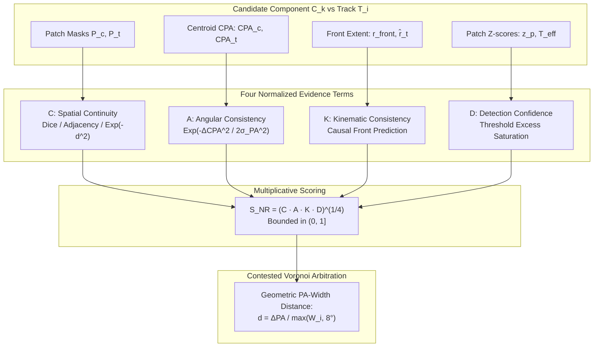

# Stereo_COR2 Pipeline Mathematical Formula Registry

**Document Identifier**: `REG-FORMULA-2026-11`  
**Reference Worktree**: `~/stereo_cor2_a5bnr`  
**Reference Branch**: `experiment/full-pipeline-audit` (derived from `39d5691`)  
**Pipeline Standard**: Dual-Archive North-Up No-MSB D4 Detection with A5b-NR1 Tracking

---

## 1. Overview & Mathematical Structure

This registry formalizes the mathematical formulations implemented across the nine canonical stages of the STEREO-A COR2 CME detection and tracking pipeline. Each formula is cross-referenced with its exact source code file, function, input/output types, numerical properties, potential limitations, and sensitivity characteristics.

---

## 2. Stage-by-Stage Mathematical Formulations

### Stage 1: Preprocessing & Running-Difference Formation

#### Formula 1.1: SEBIP Electronic Bitshift Decompression
- **Location**: `cme_pipeline/north_up_preprocessing.py`, `_legacy_sebip()`, lines 35–50
- **Equation**:
  $$I_{\text{decomp}}(x, y) = I_{\text{raw}}(x, y) \cdot 2^{N_1} \cdot 64^{N_{16} + N_{17}} \cdot 4^{N_{53} \cdot \mathbb{I}(\text{IPSUM} > 0)}$$
- **Terms**:
  - $I_{\text{raw}}$: Raw 16-bit FITS integer array.
  - $N_k$: Occurrence count of SECCHI onboard image processing opcode $k$ in header record `IP_00_19`.
  - $\mathbb{I}$: Indicator function evaluating to 1 if onboard summing `IPSUM` $> 0$, else 0.
- **Classification**: Instrumental / Mathematical.
- **Properties**: Strictly multiplicative, discrete powers of 2. Inversion of onboard lossy/lossless integer downscaling.

#### Formula 1.2: Normalized Bias Subtraction & Radiance Conversion
- **Location**: `cme_pipeline/north_up_preprocessing.py`, `calibrate_no_msb()`, lines 52–82
- **Equation**:
  $$I_{\text{cal}}(x, y) = \frac{I_{\text{decomp}}(x, y)}{t_{\text{exp}}} - \frac{B_{\text{pedestal}}}{t_{\text{exp}}}$$
- **Units**: $\text{DN}\cdot\text{s}^{-1}$ (detector digital numbers per second).
- **Classification**: Instrumental / Physical.
- **Properties**: Linear normalization by exposure time $t_{\text{exp}}$. Eliminates exposure duration scaling discrepancies between calibration rolls and science sequences.

#### Formula 1.3: Static Occulter Mask Downsampling
- **Location**: `cme_pipeline/north_up_preprocessing.py`, `downsample_static_mask()`, lines 116–124
- **Equation**:
  $$M_{256}(i, j) = \mathbb{I}\left( \frac{1}{64} \sum_{u=0}^7 \sum_{v=0}^7 M_{2048}(8i + u, 8j + v) \ge 0.95 \right)$$
- **Classification**: Heuristic / Numerical.
- **Properties**: Block-average reduction followed by step-function thresholding at $0.95$.
- **Limitations**: Step-function discontinuity at $0.95$ causes edge pixels to flip abruptly depending on fractional sub-pixel alignment.

#### Formula 1.4: Running-Difference (RD) Formulation
- **Location**: `cme_pipeline/north_up_preprocessing.py`, `run_no_msb_north_up()`, lines 258–266
- **Equation**:
  $$\Delta I_t(x, y) = \begin{cases} I_t(x, y) - I_{t - \Delta t}(x, y), & \text{if } V_t(x, y) \land V_{t - \Delta t}(x, y) \\ 0.0, & \text{otherwise} \end{cases}$$
- **Conditions**: $| \Delta t - 1800\,\text{s} | \le 2\,\text{s}$.
- **Classification**: Physical / Instrumental.
- **Properties**: First-order temporal difference over nominal 30-minute interval. Highlights moving density gradients; cancels static F-corona dust and quiescent K-corona background.

---

### Stage 2: Multi-Scale Hierarchical D4 Detection

#### Formula 2.1: Normalized Gaussian Convolution & Robust Frame Standardization
- **Location**: `cme_pipeline/live_detection.py`, `_smooth_and_z()`, lines 45–71
- **Equations**:
  $$I_{\text{smooth}}(x, y) = \frac{(I_{\text{RD}} \cdot V) * G_\sigma(x, y)}{V * G_\sigma(x, y)}, \quad \sigma = 1.0\,\text{px}$$
  $$\mu = \frac{1}{|V|} \sum_{(x,y) \in V} I_{\text{smooth}}(x, y), \quad \sigma_z = \sqrt{\frac{1}{|V|} \sum_{(x,y) \in V} (I_{\text{smooth}}(x, y) - \mu)^2}$$
  $$z(x, y) = \frac{I_{\text{smooth}}(x, y) - \mu}{\sigma_z}$$
- **Classification**: Statistical / Numerical.
- **Properties**: Normalized convolution prevents invalid occulter pixels from bleeding zeros into the corona.
- **Limitations**: Frame-level standard deviation $\sigma_z$ is sensitive to large, intense CMEs; a massive CME inflates $\sigma_z$, paradoxically lowering the standardized $z$-score of faint trailing features.

#### Formula 2.2: Multi-Scale Patch Activity Metric
- **Location**: `cme_pipeline/live_detection.py`, `_scores()`, lines 28–43
- **Equation**:
  $$A_s(u, v) = \operatorname{Quantile}_{0.95}\left( \{ |z(x, y)| : (x, y) \in \mathcal{P}_s(u, v) \land V(x, y) \} \right)$$
- **Scales**: $s \in \{16, 8, 4\}\,\text{pixels}$; patch sets $\mathcal{P}_s(u, v)$ partition the $256 \times 256$ grid into $(16 \times 16)$, $(32 \times 32)$, and $(64 \times 64)$ blocks.
- **Classification**: Statistical / Heuristic.
- **Properties**: Bounded lower quantile avoids cosmic-ray sensitivity while preserving high sensitivity to coherent fronts occupying $\ge 5\%$ of patch area.

#### Formula 2.3: Causal Trailing 24-Hour MAD Thresholding (T24)
- **Location**: `cme_pipeline/live_detection.py`, `_threshold()`, lines 73–81, 248–256
- **Equation**:
  $$T_{24, s}(t) = \operatorname{Median}(\mathcal{H}_s(t)) + 3.0 \cdot 1.4826 \cdot \operatorname{MAD}(\mathcal{H}_s(t))$$
- **History Pool**:
  $$\mathcal{H}_s(t) = \bigcup_{t_k \in [t - 24\,\text{h}, t)} \{ A_s(u, v; t_k) : \text{accepted}_s(u, v) \}$$
- **Classification**: Statistical / Mathematical.
- **Properties**: Fully causal (strictly $t_k < t$); robust against outliers via median and median absolute deviation. Asymptotic consistency factor $1.4826$ ensures equivalence to 3-sigma under a normal distribution.

#### Formula 2.4: Outer Annulus P95 Background Floor
- **Location**: `cme_pipeline/live_detection.py`, `_outer_background_p95()`, lines 115–133
- **Equation**:
  $$F_{\text{outer}}(t) = \operatorname{Quantile}_{0.95}\left( \{ A_4(u, v; t) : r(u, v) \in [88.0, 116.0]\,\text{px} \land \text{accepted}_4(u, v) \} \right)$$
  $$T_{\text{effective}}(t) = \max\left( T_{24, 4}(t), \, F_{\text{outer}}(t), \, 0.50 \right)$$
- **Classification**: Empirical / Heuristic.
- **Properties**: Triple maximum operation prevents threshold starvation during extended solar minimum conditions.
- **Limitations**: The constant $0.50$ is a hardcoded numerical floor without a dynamic coronal noise model.

#### Formula 2.5: Nested Quadtree Hierarchical Gating
- **Location**: `cme_pipeline/live_detection.py`, `_pure_hierarchy()`, lines 149–154
- **Equations**:
  $$G_{16}(u, v) = \mathbb{I}(A_{16}(u, v) > T_{24, 16})$$
  $$G_8(i, j) = \mathbb{I}(A_8(i, j) > T_{24, 8}) \land G_{16}(\lfloor i/2 \rfloor, \lfloor j/2 \rfloor)$$
  $$G_4(x, y) = \mathbb{I}(A_4(x, y) > T_{\text{effective}}) \land G_8(\lfloor x/2 \rfloor, \lfloor y/2 \rfloor)$$
- **Classification**: Heuristic / Mathematical.
- **Properties**: Pure nested quadtree hierarchy. Ensures small $4 \times 4$ detections are spatially anchored inside macro-scale $16 \times 16$ coronal activity regions.

---

### Stage 3: A5b-NR1 Redesigned Normalized Multiplicative Tracking

#### Formula 3.1: Candidate Eligibility Decision Boundary
- **Location**: `cme_pipeline/stages/tracking/v11_redesigned_normalized_a5b.py`, lines 235–246
- **Equation**:
  $$\text{Eligible}(C_k, T_i) \iff (N_{\text{direct}} > 0) \lor (N_{\text{adj}} > 0) \lor \Big( |\operatorname{circ\_diff}(\text{CPA}_k, \text{ROI}_{\text{center}})| \le (\text{ROI}_{\text{half}} + 5^\circ) \land r_{\text{min}, k} \le (r_{\text{front}, i} + 30\,\text{px}) \land r_{\text{front}, k} \ge (r_{\text{min}, i} - 8\,\text{px}) \Big)$$
- **Classification**: Heuristic / Empirical.
- **Properties**: Disjunctive boolean predicate uniting direct spatial overlap, 8-neighbor boundary adjacency, and directional/radial corridor continuity.

#### Formula 3.2: Spatial Continuity ($C$)
- **Location**: `cme_pipeline/stages/tracking/a5b_nr_scoring.py`, `compute_spatial_continuity()`, lines 36–103
- **Formulation**:
  $$C = \begin{cases} 
  0.50 + 0.50 \cdot \dfrac{2 |P_c \cap P_t|}{|P_c| + |P_t|}, & \text{if } |P_c \cap P_t| > 0 \quad (\text{Direct Overlap}) \\[8pt]
  0.30 + 0.20 \cdot \operatorname{clip}\left( \dfrac{|P_c \cap \operatorname{Dilate}_8(P_t)|}{\min(|P_c|, |P_t|)}, \, 0.0, \, 1.0 \right), & \text{if } |P_c \cap \operatorname{Dilate}_8(P_t)| > 0 \quad (\text{Adjacency}) \\[8pt]
  \operatorname{clip}\left( 0.30 \cdot \exp\left( -\dfrac{(d_{\text{min}} - 1)^2}{2 \sigma_s^2} \right), \, 10^{-4}, \, 0.30 \right), & \text{otherwise} \quad (\text{Non-Contact Proximity})
  \end{cases}$$
  where $\sigma_s = 4.0\,\text{patches}$ ($16.0\,\text{pixels}$).
- **Classification**: Mathematical / Heuristic.
- **Properties**: Strictly partitioned into three monotonic regimes:
  - Direct overlap: $C \in (0.50, 1.00]$
  - Adjacency: $C \in [0.30, 0.50]$
  - Non-contact: $C \in [10^{-4}, 0.30)$
- **Resolution of A5b-N Defect**: Replaces unbounded dilated overlap ratio (which peaked at $4.15$) with bounded Sørensen–Dice coefficient, eliminating clipping saturation.

#### Formula 3.3: Angular Consistency ($A$)
- **Location**: `cme_pipeline/stages/tracking/a5b_nr_scoring.py`, `compute_angular_consistency()`, lines 105–125
- **Formulation**:
  $$\Delta\text{CPA} = |\operatorname{circ\_diff}(\text{CPA}_c, \text{CPA}_t)| = \left| \left( (\text{CPA}_c - \text{CPA}_t + 180^\circ) \pmod{360^\circ} \right) - 180^\circ \right|$$
  $$\sigma_{\text{PA}} = \operatorname{clip}\left( 0.50 \cdot W_{\text{ROI}}, \, 12.0^\circ, \, 30.0^\circ \right)$$
  $$A = \operatorname{clip}\left( \exp\left( -\frac{\Delta\text{CPA}^2}{2 \sigma_{\text{PA}}^2} \right), \, 10^{-4}, \, 1.0 \right)$$
- **Classification**: Mathematical / Statistical.
- **Properties**: Continuous circular Gaussian kernel. Bounded angular uncertainty clamp $[12.0^\circ, 30.0^\circ]$ accommodates CME lateral expansion without allowing wide lobes to associate with opposing-quadrant structures.
- **Resolution of A5b-N Defect**: Replaces piecewise linear cutoff ($A=0$ when $|\Delta\text{CPA}| \ge 35^\circ$) with continuous exponential decay, eliminating zero-collapse.

#### Formula 3.4: Kinematic Consistency ($K$)
- **Location**: `cme_pipeline/stages/tracking/a5b_nr_scoring.py`, `compute_kinematic_consistency()`, lines 128–180
- **Formulation**:
  $$\hat{v}_r = \begin{cases} 
  \operatorname{clip}\left( \dfrac{r_{t_{-1}} - r_{t_{-2}}}{\Delta t_{\text{hist}}}, \, 0.0, \, 0.025\,\text{px/s} \right), & \text{if } N_{\text{obs}} \ge 2 \\[8pt]
  0.005\,\text{px/s} \quad (\approx 450\,\text{km/s}), & \text{otherwise}
  \end{cases}$$
  $$\hat{r}_t = r_{\text{prev}} + \hat{v}_r \cdot \Delta t_{\text{curr}}$$
  $$\sigma_r = \begin{cases} \max(8.0\,\text{px}, \, 0.15 \cdot \hat{r}_t), & \text{if } N_{\text{obs}} \ge 2 \\ \max(12.0\,\text{px}, \, 0.25 \cdot \hat{r}_t), & \text{otherwise} \end{cases}$$
  $$K = \operatorname{clip}\left( \exp\left( -\frac{(r_{\text{front}, c} - \hat{r}_t)^2}{2 \sigma_r^2} \right), \, 10^{-4}, \, 1.0 \right)$$
- **Classification**: Physical / Statistical.
- **Properties**: Fully causal linear trajectory extrapolation. Inward displacements receive smooth Gaussian penalty rather than step-function annihilation.
- **Resolution of A5b-N Defect**: Eliminates the binary step function ($K=0$ if $r_c \le r_{\text{prev}}$) that caused 19 out of 60 candidate scores to collapse to zero in A5b-N.

#### Formula 3.5: Detection Confidence ($D$)
- **Location**: `cme_pipeline/stages/tracking/a5b_nr_scoring.py`, `compute_detection_confidence()`, lines 183–225
- **Formulation**:
  $$\text{Excess} = \max\left( 0.0, \, \operatorname{Median}_{p \in C_k}(z_p) - T_{\text{effective}} \right)$$
  $$\tau_D = \max(1.0, \, T_{\text{effective}})$$
  $$D = \operatorname{clip}\left( 0.50 + 0.50 \cdot \left( 1.0 - \exp\left( -\frac{\text{Excess}}{\tau_D} \right) \right), \, 0.10, \, 1.0 \right)$$
- **Classification**: Statistical / Heuristic.
- **Properties**: Asymptotically approaches $1.0$ as median patch $z$-score exceeds threshold; neutral fallback $0.50$ when detection scores are unavailable.
- **Resolution of A5b-N Defect**: Replaces leading-front radius bonus ($F = r_{\text{front}} / 100\,\text{px}$), which artificially rewarded distant peripheral noise, with actual D4 signal intensity.

#### Formula 3.6: Geometric-Mean Composite Score ($S_{NR}$)
- **Location**: `cme_pipeline/stages/tracking/a5b_nr_scoring.py`, `compute_nr_score()`, lines 227–238
- **Formulation**:
  $$S_{NR} = (C \cdot A \cdot K \cdot D)^{1/4} = \exp\left( \frac{\ln C + \ln A + \ln K + \ln D}{4} \right) \in (0, 1]$$
- **Classification**: Mathematical.
- **Properties**: Equal-weight geometric mean. Multiplicative formulation ensures candidate must demonstrate balanced evidence across spatial, angular, kinematic, and detection domains.

#### Formula 3.7: Contested Component Voronoi Partitioning
- **Location**: `cme_pipeline/stages/tracking/v11_redesigned_normalized_a5b.py`, lines 367–378
- **Equation**:
  $$\text{Owner}(p) = \operatorname{argmin}_{i \in \text{Claimants}} \left( \frac{|\operatorname{circ\_diff}(\text{PA}_p, \text{CPA}_i)|}{\max(W_i, \, 8.0^\circ)}, \quad i \right)$$
- **Classification**: Heuristic / Mathematical.
- **Properties**: Purely geometric PA-width normalized angular distance. Preserved strictly unchanged from baseline A5b, ensuring exact bitwise mask invariance in NR1.

---

### Stage 4: Association

#### Formula 4.1: Track-to-Family 1:1 Identity Mapping
- **Location**: `cme_pipeline/stages/association/v01_identity_association.py`, lines 77–80
- **Equation**:
  $$\text{FamilyID}(T_i) = \text{FAM\_T}\{i : 02d\}$$
  $$\text{IsAnchor}(T_i) \iff r_{\text{birth}, i} \le 30.0\,\text{px}$$
- **Classification**: Architectural / Mathematical.
- **Properties**: Direct bijective mapping. Multi-component tracking in Stage 3 groups fragmented lobes under a single Track ID, removing the need for heuristic parent-child graph merging (Rule B).

---

### Stage 5: Downstream Admission Gates

#### Formula 5.1: Solar Root Birth Radius Gate
- **Location**: `cme_pipeline/stages/gates/v01_birth_radius_gate.py`, lines 38–48
- **Decision Rule**:
  $$\text{Admit}_{\text{birth}}(\text{FAM}_k) \iff \exists T_i \in \text{FAM}_k : r_{\text{birth}, i} \le 30.0\,\text{px}$$
- **Classification**: Instrumental / Physical.
- **Properties**: Rejects tracks birthed in the mid-to-outer corona ($> 30\,\text{px} \approx 3.8\,R_\odot$) as secondary detached fragments or noise fluctuations.

#### Formula 5.2: Size-Qualified Consecutive Persistence Gate
- **Location**: `cme_pipeline/stages/gates/v01_family_size_gate.py`, lines 75–105
- **Decision Rule**:
  $$\text{Qualified}(t) \iff \sum_{p \in \text{FAM}_k(t)} 1 \ge 10\,\text{patches}$$
  $$\text{Admit}_{\text{persistence}}(\text{FAM}_k) \iff \max_{\text{consecutive run}} \left( \sum_{t=t_{\text{start}}}^{t_{\text{end}}} \mathbb{I}(\text{Qualified}(t)) \right) \ge 3\,\text{pairs}$$
- **Classification**: Physical / Statistical.
- **Properties**: Requires $\ge 1.5\,\text{hours}$ of continuous, macro-scale outward propagation ($\ge 160\,\text{pixels}$ area), rejecting transient glints and flare flashes.

---

### Stage 6: Signed Dynamic PA Recovery

#### Formula 6.1: Dynamic Position Angle Expansion Corridor
- **Location**: `cme_pipeline/stages/recovery/v01_signed_pa_recovery.py`, lines 67–79
- **Equations**:
  $$\text{PA}_{\text{start}} = (\text{PA}_{\text{min}} - 5.0^\circ) \pmod{360^\circ}, \quad \text{PA}_{\text{end}} = (\text{PA}_{\text{max}} + 5.0^\circ) \pmod{360^\circ}$$
  $$\text{Span}_{\text{PA}} = (\text{PA}_{\text{end}} - \text{PA}_{\text{start}}) \pmod{360^\circ}, \quad \text{CPA} = \left(\text{PA}_{\text{start}} + \frac{\text{Span}_{\text{PA}}}{2}\right) \pmod{360^\circ}$$
- **Classification**: Heuristic / Geometric.
- **Properties**: Dynamically tracks expanding CME lateral flank envelope across observation frames.

#### Formula 6.2: Domain A Robust Local Background Normalization
- **Location**: `cme_pipeline/stages/recovery/v01_signed_pa_recovery.py`, lines 80–92
- **Equations**:
  $$\mathcal{S}_{\text{local}} = \{ I_{\text{smooth}}(x, y) : |\operatorname{circ\_diff}(\text{PA}(x, y), \text{CPA})| \le \frac{\text{Span}_{\text{PA}}}{2} \land V(x, y) \}$$
  $$\tilde{\mu} = \operatorname{Median}(\mathcal{S}_{\text{local}}), \quad \tilde{\sigma} = 1.4826 \cdot \operatorname{MAD}(\mathcal{S}_{\text{local}})$$
  $$z_{\text{local}}(x, y) = \frac{I_{\text{smooth}}(x, y) - \tilde{\mu}}{\max(\tilde{\sigma}, \, 10^{-4})}$$
- **Classification**: Statistical / Robust.
- **Properties**: Local angular sector baseline subtraction accounts for coronal streamer background variations within the active quadrant.

#### Formula 6.3: Signed Morphological Seed Propagation
- **Location**: `cme_pipeline/stages/recovery/v01_signed_pa_recovery.py`, lines 112–134
- **Conditions**:
  $$p \in \text{CandidateRecovery} \iff (r_p \in [16.33\,\text{px}, \, \hat{r}_{\text{front}} + 13.35\,\text{px}]) \land (A_{\text{local}, 4}(p) > T_{24, 4}) \land (\bar{z}_{\text{global}}(p) > 0.0)$$
  $$\text{RecoveredMask} = \operatorname{BinaryPropagation}_8(\text{SeedPatches}, \, \text{CandidateRecovery} \cup \text{SeedPatches})$$
- **Classification**: Heuristic / Morphological.
- **Properties**: Constrains recovery to positive density enhancements connected to the validated tracking core.

---

### Stage 7: Island-First Sub-Patch Pixel Segmentation

#### Formula 7.1: Pixel-Level Occulter and FOV Bounding
- **Location**: `cme_pipeline/stages/segmentation/v01_island_first_segmentation.py`, lines 77–86
- **Equation**:
  $$\text{ROI}_{\text{pixel}}(x, y) = \operatorname{Kronecker}_{4 \times 4}(\text{RecoveredMask}) \land (r(x, y) \in [22.0\,\text{px}, \, 122.5\,\text{px}]) \land V(x, y)$$
  $$\text{Core}_{\text{pixel}}(x, y) = \text{ROI}_{\text{pixel}}(x, y) \land (z_{\text{global}}(x, y) > 0.0)$$
- **Classification**: Instrumental / Physical.
- **Properties**: Restricts pixel segmentation strictly inside the unvignetted COR2 aperture ($22.0\,\text{px} \le r \le 122.5\,\text{px}$).

#### Formula 7.2: Morphological Island Filtering & Hole Closure
- **Location**: `cme_pipeline/stages/segmentation/v01_island_first_segmentation.py`, lines 88–105
- **Equations**:
  $$\text{RetainedIslands} = \bigcup_{k} \{ \mathcal{I}_k : \operatorname{Area}(\mathcal{I}_k) \ge 16\,\text{pixels} \}$$
  $$\text{FilledMask} = \text{RetainedIslands} \cup \bigcup_{m} \{ \mathcal{H}_m : \operatorname{Area}(\mathcal{H}_m) \le 16\,\text{pixels} \land \mathcal{H}_m \subset \text{ROI}_{\text{pixel}} \}$$
- **Classification**: Heuristic / Morphological.
- **Properties**: Discards single-pixel noise islands while filling small interior holes $\le 16\,\text{px}$. Preserves physical low-density flux-rope cavities ($> 100\,\text{px}$).

---

### Stage 8: Independent CME Catalog & Kinematics Extraction

#### Formula 8.1: Minimal Circular Enclosing Arc (CPA & Angular Width)
- **Location**: `cme_pipeline/utils/geometry.py`, `minimal_circular_enclosing_arc()`, lines 35–85
- **Equations**:
  $$\text{AngularWidth} = \min_{\text{arc}} \left( \text{Span}(\text{arc}) : \text{PA}(x, y) \in \text{arc} \quad \forall (x, y) \in \text{Mask}_{\text{peak}} \right)$$
  $$\text{CPA} = \operatorname{Center}(\text{arc}_{\text{min}})$$
- **Classification**: Mathematical / Geometric.
- **Properties**: Exact minimal bounding sector over the circular manifold $S^1$, correctly handling $0^\circ / 360^\circ$ wraparound.

#### Formula 8.2: First-Order Linear Height-Time Polyfit Kinematics
- **Location**: `cme_pipeline/stages/segmentation/cme_catalog.py`, `build_cme_catalog()`, lines 88–102
- **Equations**:
  $$h_i = \left( \max_{(x,y) \in \text{Mask}(t_i)} r(x, y) \right) \cdot \frac{R_\odot}{\text{rsun\_px}}, \quad t_i = \text{seconds since } t_0$$
  $$\hat{v}_{\text{plane-of-sky}} = \frac{\sum_{i=1}^N (t_i - \bar{t})(h_i - \bar{h})}{\sum_{i=1}^N (t_i - \bar{t})^2}$$
  $$R^2 = 1.0 - \frac{\sum_{i=1}^N (h_i - (\hat{v} t_i + \hat{h}_0))^2}{\sum_{i=1}^N (h_i - \bar{h})^2}$$
  $$\text{Quality} = \begin{cases} \text{EXPLORATORY}, & \text{if } N \ge 3 \land \hat{v} > 0 \land R^2 \ge 0.50 \\ \text{LOW\_CONFIDENCE}, & \text{if } N \ge 3 \land (\hat{v} \le 0 \lor R^2 < 0.50) \\ \text{INSUFFICIENT\_FRAMES}, & \text{if } N < 3 \end{cases}$$
- **Classification**: Statistical / Linear Regression.
- **Properties**: Standard image-plane projected velocity estimator. $R^2 \ge 0.50$ threshold flags erratic or accelerating trajectories.

---

### Stage 9: External Catalog Validation

#### Formula 9.1: Circular Sector Angular IoU
- **Location**: `cme_pipeline/stages/validation/v01_external_catalog_validation.py`, lines 16–22
- **Equations**:
  $$\text{IoU}_{\text{sector}}(\mathcal{S}_{\text{pipeline}}, \mathcal{S}_{\text{catalog}}) = \frac{\operatorname{Span}(\mathcal{S}_{\text{pipeline}} \cap \mathcal{S}_{\text{catalog}})}{\operatorname{Span}(\mathcal{S}_{\text{pipeline}} \cup \mathcal{S}_{\text{catalog}})}$$
- **Classification**: Mathematical / Empirical.
- **Properties**: Bounded metric in $[0.0, 1.0]$ quantifying angular overlap against official coronagraph catalogs (SEEDS, CACTus, CORSET).
